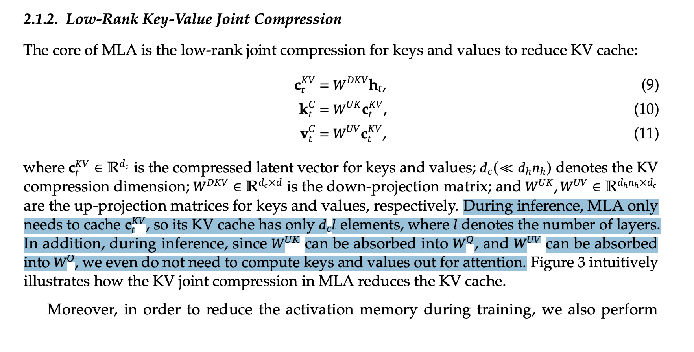
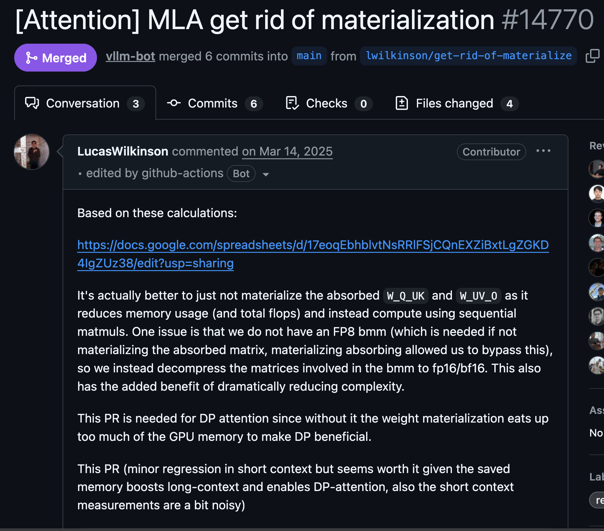
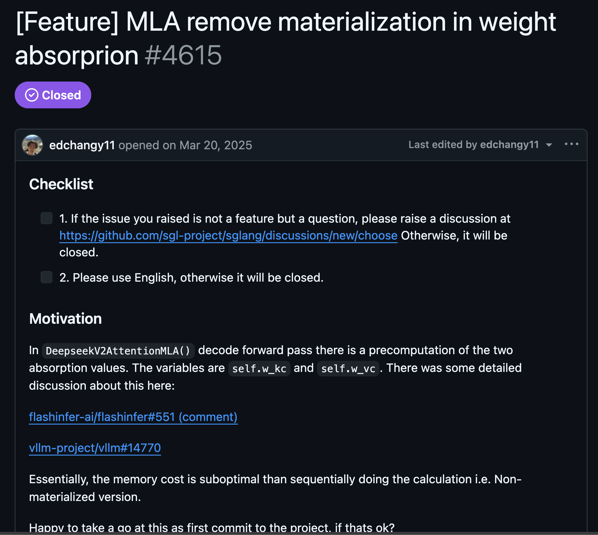
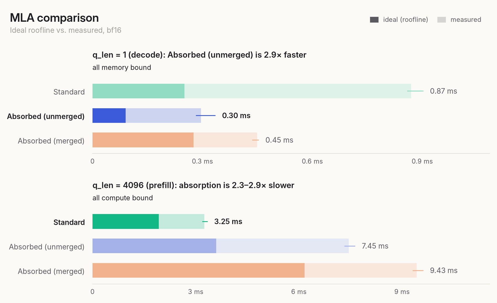
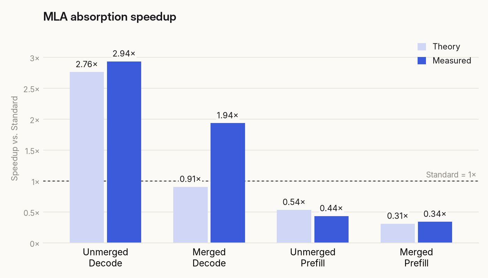
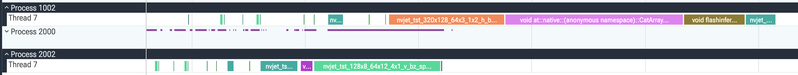
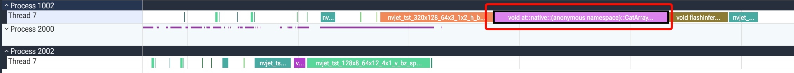

# MLA Lab

Theoretical roofline analysis & mini experiment for a deeper understanding of MLA weight absorption.

## About weight absorption

> [!NOTE]
> I assume the reader is already familiar with MLA (Multi-head Latent Attention) introduced in DeepSeek-V2. If not, I recommend reading [my earlier note](https://github.com/junuxyz/mlsys-notes/blob/main/notes/transformer/mla.md) on it.

First of all, what is weight absorption in MLA?

If we only think about attention score calculation (leaving out the separate RoPE contribution), it is:

$$
S = QK^{\mathsf{T}} = C_q W_{uq} (C_{kv} W_{uk})^{\mathsf{T}}
$$

where:

- $S$: content attention scores, before scaling and softmax.
- $Q$, $K$: query and key matrices.
- $C_q$, $C_{kv}$: compressed query and joint key-value representations.
- $W_{uq}$, $W_{uk}$: up-projection weights that reconstruct $Q$ from $C_q$ and $K$ from $C_{kv}$, respectively.
- $\mathsf{T}$: matrix transpose. Multiplication between matrices is implied.

The most straightforward way (semantically) is to reconstruct $Q$ and $K$ and then do $QK^{\mathsf{T}}$. We'll call this the standard method.

The problem with this method is that it requires us to load the projected $K$ from memory in every forward pass. This isn't necessarily a problem during prefill (since it is mostly compute-bound even considering chunked prefill) but during the decode phase, which is usually memory-bound, [reconstructing KV](theory.py#L41-L43) and loading them from memory [increases the amount of KV data to read and write](theory.py#L70-L73).

In order to avoid this, we try to absorb $W_{uk}$ into $Q$ instead of projecting $K$.

This is possible due to the associative property of matrix multiplication ($A(BC) = (AB)C$).

So in the attention score equation,

$$
\begin{aligned}
S &= QK^{\mathsf{T}} \\
  &= C_q W_{uq} (C_{kv} W_{uk})^{\mathsf{T}} \\
  &= C_q W_{uq} W_{uk}^{\mathsf{T}} C_{kv}^{\mathsf{T}} \\
  &= (C_q W_{uq} W_{uk}^{\mathsf{T}}) C_{kv}^{\mathsf{T}}
\end{aligned}
$$

### MLA in Prefill vs Decode

The tradeoff with weight absorption is that it increases the FLOPs for the attention computation itself. This is because multiplying $Q$ by $W_{uk}^{\mathsf{T}}$ projects each query head from its head dim ($128$) to the latent dim ($512$).

As a result, when computing the content attention scores, the absorbed weight method uses the latent dim ($512$) instead of the head dim ($128$) as the reduction dimension. This leads to $4\times$ the FLOPs for the final content score calculation.

I explicitly mention the **"final content score calculation"** because this doesn't necessarily represent the total FLOP cost. In fact, for the configurations tested here, weight absorption leads to fewer total FLOPs during decode and more total FLOPs during prefill. You can check this in [`theory.py`](theory.py) for more details: [128 dims per head](theory.py#L49-L54) vs [512 dims per head](theory.py#L102-L107).

As a consequence, during prefill, which is compute-bound, it is known to perform suboptimally compared to standard $K$ projection.

### "Weight absorption" is an ambiguous term!

There is one thing that confused me (and the maintainers of open-source inference engines) at first. At the top, I simply assumed we would multiply $Q$ by $W_{uk}^{\mathsf{T}}$ without any explanation about it. However, to be accurate, there are _two_ ways to do weight absorption.

Method 1 (unmerged weights): We can [up-project the query first and then apply $W_{uk}^{\mathsf{T}}$](theory.py#L91-L96).

$$
\begin{aligned}
S &= QK^{\mathsf{T}} = \cdots \\
  &= (C_q W_{uq} W_{uk}^{\mathsf{T}}) C_{kv}^{\mathsf{T}} \\
  &= \bigl((C_q W_{uq}) W_{uk}^{\mathsf{T}}\bigr) C_{kv}^{\mathsf{T}}
\end{aligned}
$$

or with Method 2 (merged weights): we can [merge the weights first and then apply them to the down-projected query](theory.py#L158-L160):

$$
\begin{aligned}
S &= QK^{\mathsf{T}} = \cdots \\
  &= (C_q W_{uq} W_{uk}^{\mathsf{T}}) C_{kv}^{\mathsf{T}} \\
  &= \bigl(C_q (W_{uq} W_{uk}^{\mathsf{T}})\bigr) C_{kv}^{\mathsf{T}}
\end{aligned}
$$

<p align="center">
  
  <br />
  <sub>Figure 1. The <a href="https://arxiv.org/abs/2405.04434">DeepSeek-V2 report</a> describes absorbing the key and value up-projection weights into the query and output projections, but does not distinguish between merged and unmerged implementations.</sub>
</p>

Unfortunately, the DeepSeek-V2 technical report explains _weight absorption_ in a vague way, which makes it hard to understand exactly which method is used. This was the main motivation for why I made this repository.

After doing some searching, I found that maintainers of open-source repos such as [FlashInfer](https://github.com/flashinfer-ai/flashinfer) or [vLLM](https://github.com/vllm-project/vllm/) were also confused by the term and initially implemented it by merging weights together.

<p align="center">
  
  <br />
  <sub>Figure 2. A <a href="https://github.com/vllm-project/vllm/pull/14770">vLLM PR</a> on removing materialization of the merged weights.</sub>
</p>

<p align="center">
  
  <br />
  <sub>Figure 3. <a href="https://github.com/sgl-project/sglang/issues/4615">SGLang issue</a> raising the same concern about precomputing merged weights.</sub>
</p>


I found a valuable debate in a [FlashInfer PR](https://github.com/flashinfer-ai/flashinfer/pull/551), especially [this comment](https://github.com/flashinfer-ai/flashinfer/pull/551#issuecomment-2665697147) which explicitly compares the unmerged weight method vs the merged weight method. The conclusion these inference repos ended up with was: **unmerged weights perform the best in decode, while the standard version works best in prefill.**

While the comment I've mentioned was useful, following the full reasoning was a bit dense for me. So I made a more readable, complete analysis and added a controlled experiment that compares the three cases (standard, merged, and unmerged) during both prefill (q,k,v = 4,096) and decode (q=1, k,v=4096).

I've organized the experiments into the following four files: 

- `theory.py`: I estimated the ideal time of each method for both prefill and decode based on the roofline analysis method in Scaling Book. 
- `measure.py`: I actually wanted to see how much the theoretical analysis matched reality. I measured it using FlashInfer on an H100 provided by Modal.
- `analyze.py`: Finally, I compared theory vs measurement and checked the gap.
- `profile.py`: I profiled Standard and merged absorption during decode to investigate the discrepancy.

The main objectives were:

1. Check if the standard method is best in prefill.
2. Check if the unmerged weight method is best in decode.
3. Check all cases on real hardware (H100) to see if theory aligns with measurement.

I've written down more details of each in the section below.

## Result (or TLDR)

<p align="center">
  
  <br />
  <sub>Figure 4. Ideal roofline time (solid bars) and measured median time (lighter bars) for each method on H100.</sub>
</p>

All real calculations had some amount of overhead, possibly due to the assumptions I've made (written in the theory.py section below). 

However, we can see the overall trend aligning: during decode (q=1, kv=4096), the unmerged weight method performs the best. On the other hand, the standard method works the best during prefill (q=4096).

These results are specific to the batch size, sequence lengths, precision, and implementations tested here.

Let's also compare the relative difference between theoretical analysis and actual measurements.

<p align="center">
  
  <br />
  <sub>Figure 5. Theoretical and measured speedups relative to Standard. Values above the dashed 1× line are faster than Standard while values below it are slower.</sub>
</p>

If we compare speedups relative to the standard method, most predictions were reasonably close to the measurements.

The only exception was merged absorption during decode, where the model predicted a slight slowdown, but the implementation was about 1.94× faster than Standard.

Why was this?

To understand it, I did some further [profiling](profile.py).

<p align="center">
  
  <br />
  <sub>Figure 6. GPU traces for Standard (top) and merged absorption (bottom) during decode.</sub>
</p>

The pink block in the Standard trace is PyTorch's `CatArrayBatchedCopy` kernel, launched by [`torch.cat` in the Standard implementation](measure.py#L151). FlashInfer's [`BatchPrefillWithRaggedKVCacheWrapper` with the FA3 backend](measure.py#L79-L93) takes each key as a single 192-dimensional vector, so the reconstructed 128-dimensional content keys must be packed together with the 64-dimensional positional keys before attention. This copy takes about [0.31 ms](results/profile/summary.json), and we didn't consider this in the [theoretical byte estimate](theory.py#L62-L79) at all, which accounts for most of the gap.

<p align="center">
  
  <br />
  <sub>Figure 7. The highlighted pink block is the key-packing kernel in Standard.</sub>
</p>

These profile times are sums of GPU kernel durations from one warmed forward pass, rather than the CUDA-event medians plotted above.

Subtracting the copy from the profiled GPU time still leaves the Standard method slower (about 0.42 ms vs. 0.35 ms). Much of the remaining difference seems to come from different attention kernels: [Standard runs on expanded K/V](measure.py#L146-L152) and takes about 0.11 ms, while [merged absorption's MLA kernel works directly on the compressed cache](measure.py#L182-L187) and takes about 0.02 ms.

## Details

### [`theory.py`](theory.py)

We use the [roofline measurement](https://jax-ml.github.io/scaling-book/roofline/) explained in [Scaling Book](https://jax-ml.github.io/scaling-book). We use an H100 provided by Modal, with [H100 SXM dense BF16 throughput of 989.5 TFLOP/s and HBM bandwidth of 3.35 TB/s](theory.py#L20-L23).

I've explained each matmul FLOP term so you can follow the reasoning for each method. You can check the [FLOP and byte formulas for each matmul](theory.py#L9-L11).

To keep the model simple, we make the following assumptions:

- Usually there are some hardware limits that prevent us from fully using the peak compute even when it's compute-bound. The fraction of peak compute achieved is called [MFU](https://www.glennklockwood.com/garden/mfu). However, since the three methods all use different shapes and operation orders, their MFU is likely to be different. To keep things simple, we assume we can use peak compute throughput and memory bandwidth.
- We assume [compute and memory can be completely overlapped](theory.py#L199-L211) as `max(total FLOPs / peak FLOPs/s, total bytes / peak bytes/s)`, ignoring kernel boundaries and launch overhead.
- We assume [fused attention](https://arxiv.org/abs/2205.14135), which keeps scores and probabilities on chip. We count compressed KV reads only once per attention call for both [unmerged absorption](theory.py#L141-L142) and [merged absorption](theory.py#L191-L192).
- We count only **matmul** FLOPs and bytes, while the benchmark also includes non-matmul operations and layout copies.

#### How to run the theoretical calculator

```bash
python labs/mla-lab/theory.py --q-len 1
python labs/mla-lab/theory.py --q-len 4096
```

### [`measure.py`](measure.py)

I wanted to check if the theoretical analysis aligned with actual measurements. Of course, due to the assumptions made, we wouldn't see an exact match. I still wanted to see the trend or whether some things I hadn't considered would be an issue in reality. I've used the [FlashInfer](https://github.com/flashinfer-ai/flashinfer) library with its FA3 backend and compared all three methods. The benchmark uses synthetic hidden states, weights, and cached KV tensors with DeepSeek-V2's MLA dimensions.

1. Standard: Reconstructs K and V from the compressed KV cache, combines the content and positional features for Q and K, and passes Q, K, and V to FlashInfer's `BatchPrefillWithRaggedKVCacheWrapper`. This wrapper is used for both prefill and the single-query decode case.

2. Unmerged absorption: Projects the query in two steps and passes the absorbed query, its separate RoPE features, and the compressed KV cache to `BatchMLAPagedAttentionWrapper`. Attention returns a latent output with 512 dims per head, which is projected through the value and output weights in two steps.

3. Merged absorption: Uses the same MLA attention wrapper and compressed cache but applies precomputed merged weights for the query projection and the combined value and output projection after attention.

Also some things to note here:

- We benchmark **batch=1** with `kv_len=4096` and `q_len=1, 4096` using BF16 and causal attention.
- CUDA events time the full path from input hidden states to output, including down projections, RMSNorm, RoPE, and new KV cache writes.
- Some settings differ from how we would actually use this model when serving in production. We use a batch size of 1 and eager execution with default cache behavior and **no CUDA Graph**.
- We measure the median and range of five interleaved trials per method.

#### How to run measure.py

```bash
uv run --project labs modal run labs/mla-lab/measure.py
```

### [`profile.py`](profile.py)

Profiles one warmed decode forward pass each for Standard and merged absorption. It saves kernel timings and Chrome traces under `results/profile/`; the traces can be opened in [Perfetto](https://ui.perfetto.dev/).

```bash
uv run --project labs modal run labs/mla-lab/profile.py
```

### [`analyze.py`](analyze.py)

`analyze.py` prints ideal and measured times, the model bound, theoretical and measured speedup versus Standard, and the measured/ideal ratio. It saves `comparison.csv` and two figures (`comparison.png`, `speedup.png`) under `analysis/`. Results are already presented above.

#### How to run analyze.py

```bash
uv run --project labs --with matplotlib python labs/mla-lab/analyze.py labs/mla-lab/results/modal
```


## References

- [H100 specifications](https://www.nvidia.com/en-us/data-center/h100/)
- [FlashInfer MLA API](https://docs.flashinfer.ai/api/attention.html)