# Inside DFlash

> [!NOTE]
> I originally started writing a longer piece on DFlash and follow-ups like [DFlash 2](https://inco.ai/blog/dflash2/) and [DSpark](https://arxiv.org/abs/2607.05147), when diffusion-based speculators felt like one of the notable trends of the year. This initial plan changed a bit after reading [EAGLE-4](https://github.com/eagle-hq/EAGLE-4/blob/main/EAGLE4_Paper.pdf) which shifted how I think about speculator models (especially at the system layer) where comparing parallel vs autoregressive drafting seems to be not _as_ important as I thought. I'm rewriting that broader piece and pulling this section out as a standalone note on how DFlash works under the hood.

**[Speculative decoding](https://arxiv.org/abs/2211.17192)** speeds up autoregressive generation by having a lightweight drafter propose multiple candidate tokens and verifying them in parallel with a larger target model. However in traditional setups, drafting is still **sequential**: proposing more tokens means running more draft steps, which quickly adds draft latency and caps how far ahead you can speculate.

This raises a natural question:

> Can we draft an entire block of candidate tokens in parallel instead?

DFlash explores this idea using a [block-diffusion-style](https://arxiv.org/abs/2503.09573) model that predicts a block of tokens in a single forward pass.

In this note, we walk through how DFlash works under the hood. We'll start with a full draft–verify iteration, then unpack its core pieces — including target hidden state extraction, KV injection, block attention, sampling, verification, and KV cache management — based on the [official DFlash implementation](https://github.com/z-lab/dflash) from Z-lab.

By the end of this post, you should have a clear picture of how DFlash operates step by step.

# I. Building the Mental Model

## From Sequential to Parallel Drafting

In mainstream autoregressive speculative decoding (like EAGLE-3), there is a design asymmetry: **verification is parallel, while drafting is still sequential.**

For example in [EAGLE-3](https://arxiv.org/abs/2503.01840), which is still arguably one of the most widely used speculative decoding methods in production, draft tokens are generated in an autoregressive manner. To propose $n$ (e.g., $n=7$) tokens, the drafter performs $n$ sequential prediction steps, with each step depending on previously generated tokens. Meanwhile, the target model can verify all $n$ proposals in a single forward pass.

<p align="center">
  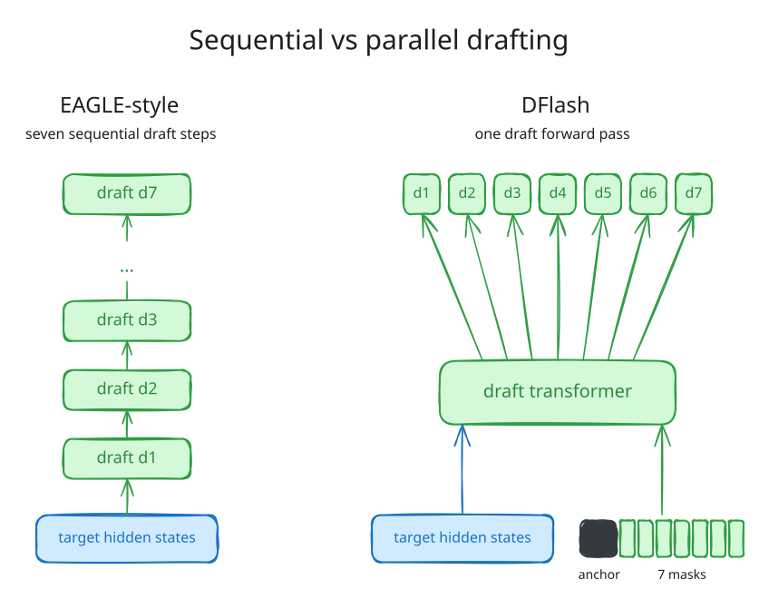
</p>

[DFlash](https://arxiv.org/abs/2602.06036), first introduced earlier this year, takes advantage of this opportunity. Instead of proposing tokens one by one, it uses a block-diffusion style draft model that predicts several future positions **together**, in a single forward pass.

Moving from sequential to parallel drafting immediately raises two practical design questions:

> **1. How can DFlash predict the seventh token without knowing what was sampled for the first six?**

Unlike an autoregressive drafter that conditions directly on previously generated token IDs, a parallel block drafter has to model relationships across positions before those tokens are finalized.

> **2. How does a small draft model predict multiple future tokens with enough accuracy?**

A small drafter cannot easily predict an entire block from scratch on its own, so it somehow needs a way to leverage the rich context representations already computed by the target model.

After we go through the full decode step of DFlash, we will be able to answer these two questions!

## Big Picture on How DFlash Works

Before diving into decoder layers, let's understand the complete system in a TLDR version.

At a high level, DFlash still follows the familiar draft–then-verify loop. The target model processes the input prompt in parallel, a lightweight drafter proposes several future tokens, and the target verifies those proposals. Accepted tokens become part of the confirmed context, and the process repeats.

The part we should focus on is **what the drafter receives and how it produces its proposals.**

Instead of relying entirely on its own token representations, the drafter receives hidden features extracted from the target model. It uses these features as context while processing an entire block of future positions in parallel.

For a concrete understanding, let's use a running example. Suppose the target model has processed 100 tokens, at positions 0 through 99, and sampled the next token at position 100.

<p align="center">
  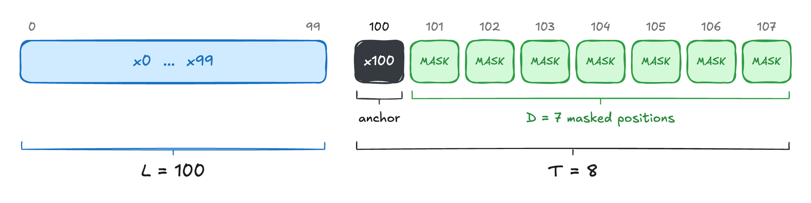
</p>

Token at position 100 is called the **anchor** that has already been sampled by the target but hasn't yet been processed through the target's Transformer layers.

Here is how DFlash serves a request on this example, starting from the target model's prefill through the first draft-verify round.

<p align="center">
  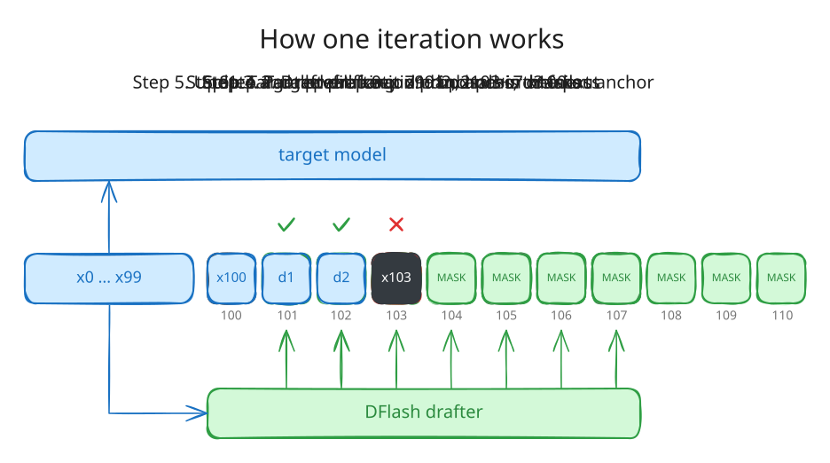
</p>

The drafter uses the target's hidden features and the current block to generate seven proposals in one forward pass. Then the target verifies them, keeps an accepted prefix, and supplies the continuation needed for the next iteration.

This involves the following five steps:

**Step 1. Target prefill**

The target processes the original context, fills its own KV cache, and samples the first generated token. It also returns the selected hidden states that draft model will use as context.

**Step 2. Draft preparation**

Draft model combines the selected target features and constructs a block containing the sampled anchor followed by seven masked positions.

**Step 3. Parallel drafting**

Draft decoder layer processes the entire block in one forward pass. Each layer reads the target hidden states and conducts attention among the block positions. After that, the output head produces seven token proposals.

**Step 4. Target verification**

The target processes the anchor and seven proposed tokens together. It accepts a consecutive prefix of the proposals using the configured verification rule.

**Step 5. Update and repeat**

Rejected speculative KV entries are discarded. The target's newly computed hidden states for confirmed tokens become additional draft context, while the target-derived continuation becomes the next anchor.

Steps 2–5 are repeated until the decoding for that request ends. Now that we've seen the big picture, let's dive deeper!

# II. Inside DFlash

Let's see how DFlash actually performs a draft–verify iteration, focusing on the things that distinguish it from an ordinary autoregressive drafter.

>[!NOTE]
> Explanation below is based on the [DFlash implementation](https://github.com/z-lab/dflash/blob/07ebd93db9f472af339b644bb70221ad8428328a/dflash/model.py) by the [original authors](https://z-lab.ai/). Note that production inference engines like vLLM add additional optimizations such as fusing kernels, capturing CUDA graphs, or managing caches differently. This easily makes another standalone article which I'll leave as a future topic to cover.

## Target KV Cache and Draft KV Cache

<p align="center">
  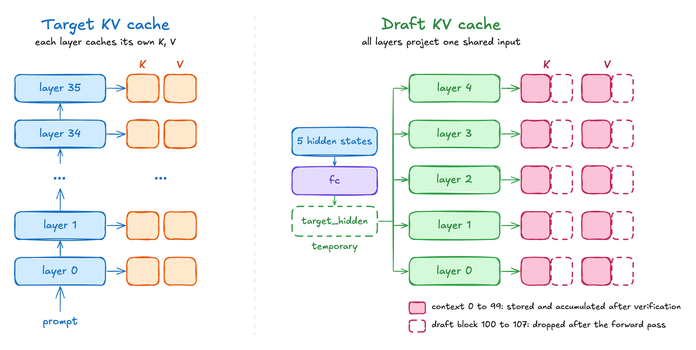
</p>

Before we move on, it is important to understand the different KV caches used here. I first didn't acknowledge this and later was confused, so I think it's worth mentioning clearly. DFlash maintains [**two separate KV caches**](https://github.com/z-lab/dflash/blob/07ebd93db9f472af339b644bb70221ad8428328a/dflash/model.py#L201-L202).

Target KV cache is the ordinary cache maintained by the target's Transformer layers. It stores K/V representations for tokens the target has processed.

Draft KV cache is again divided into two parts.

The persistent part is the KV cache each draft layer stores, based on the K/V projections of the fused target hidden states, allowing the drafter to reuse previously processed context without rebuilding it on every iteration. This is not the _ordinary sense of KV cache_. In a standard Transformer, each layer caches K/V projected from the previous layer's output within the same model, whereas here every draft layer projects the same shared fused target hidden states through its own K/V projection weights.

During a draft forward pass, the model also computes K/V representations for the current speculative block. These form a **temporary** cache only used for the current forward pass and are removed right after the forward pass is finished. Only after the target verifies a prefix do the corresponding new target hidden states become available for the persistent draft context.

## Draft Preparation

DFlash's draft model receives two distinct kinds of information which are target hidden states and draft hidden states.

**1. Target hidden states: information about the previous context**

When the target [processes the prompt](https://github.com/z-lab/dflash/blob/07ebd93db9f472af339b644bb70221ad8428328a/dflash/model.py#L205-L219) or verifies previously drafted tokens, it produces hidden representations at its Decoder layers. In DFlash, we extract hidden states from [several selected target layers](https://github.com/z-lab/dflash/blob/07ebd93db9f472af339b644bb70221ad8428328a/dflash/model.py#L25-L34), combine them through a learned projection, and make them available to the drafter. This is similar in spirit to EAGLE-3 - rather than requiring a small draft model to reconstruct everything about the context from token IDs, we reuse representations the target has already computed.

<p align="center">
  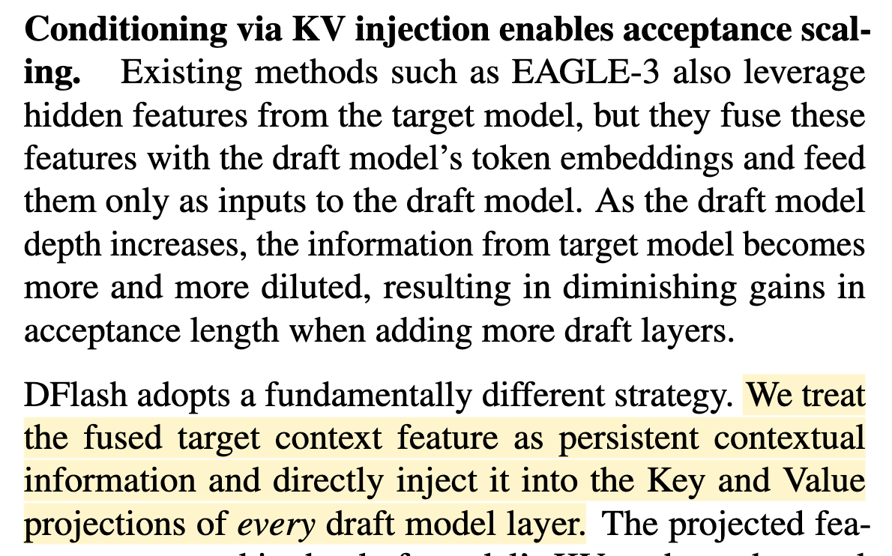
  <br />
  <sub>From the DFlash paper</sub>
</p>

The architectural detail in DFlash is that it supplies these target-derived features to **every draft decoder layer** through their key/value projections. The paper calls this mechanism _KV injection_. In our example each tensor has shape `[B, 100, H]`, where `B` is batch size and `H` is the hidden dimension.

<p align="center">
  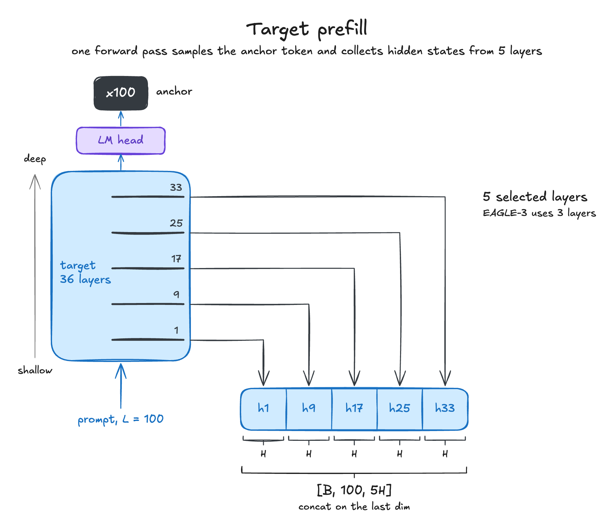
</p>

In the paper's default configuration, five tensors are concatenated along the hidden dimension, producing `[B, 100, 5H]`, then passed through a learned linear projection which reduces them back to `[B, 100, H]`. These fused features become the draft model's contextual input, called `target_hidden` in the implementation:

```python
# Extract and concatenate selected target layers -> [B, 100, 5H]
selected_states = [hidden_states[layer_id + offset] for layer_id in layer_ids]
target_hidden = torch.cat(selected_states, dim=-1)

# Project and normalize back to [B, 100, H] inside draft model forward
target_hidden = self.hidden_norm(self.fc(target_hidden))
```
Source: [`extract_context_feature`](https://github.com/z-lab/dflash/blob/07ebd93db9f472af339b644bb70221ad8428328a/dflash/model.py#L37-L43) and [`DFlashDraftModel.forward`](https://github.com/z-lab/dflash/blob/07ebd93db9f472af339b644bb70221ad8428328a/dflash/model.py#L584).

Each draft layer applies its **own K/V projection weights** to those features (the same `k_proj`/`v_proj` weights used for the draft block within that layer, **distinct** across layers) and uses the results as contextual keys and values. This means every layer reads from the same shared fused source features but projects them into its own per-layer context K/V.

When we use `target_hidden` below without any additional mention, it refers to this shared fused-and-projected `[B, L_ctx, H]` tensor rather than the raw `[B, L_ctx, 5H]` concatenation.

**2. Draft block: the positions we want to predict**

The second input consists of the anchor token followed by masked positions. For a draft block of length eight, the input looks like this:

<p align="center">
  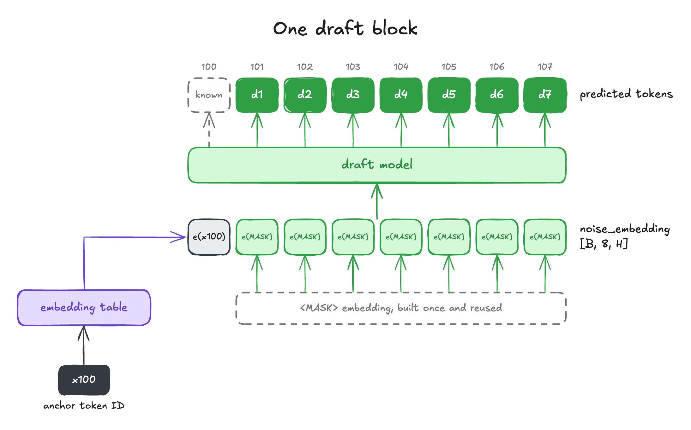
</p>

The anchor token is already _known_ at the moment, so we obtain its embedding by looking up its token ID in the target model's frozen embedding table (DFlash reuses the target's `embed_tokens` rather than maintaining its own). The remaining seven positions start with the embedding of a special `<MASK>` token (for example, `mask_token_id` for Qwen3.6-27B-DFlash is [248070](https://huggingface.co/z-lab/Qwen3.6-27B-DFlash/blob/main/config.json#L13)). Following the approach used in [block diffusion LLMs](https://arxiv.org/abs/2503.09573), these mask tokens represent unknown tokens. The draft model's goal is to denoise their values in a single forward pass. Here, _denoising_ means predicting masked tokens rather than removing Gaussian noise, which is the traditional meaning of it in Diffusion.

In the code, these input embeddings are called [`noise_embedding`](https://github.com/z-lab/dflash/blob/07ebd93db9f472af339b644bb70221ad8428328a/dflash/model.py#L235-L242). The tensor has shape `[B, 8, H]`, where `B` is the batch size, `8` is the block length in our example, and `H` is the embedding dimension.

To avoid recreating the mask embeddings at every decoding step, the implementation [initializes the buffer once](https://github.com/z-lab/dflash/blob/07ebd93db9f472af339b644bb70221ad8428328a/dflash/model.py#L197-L199) and reuses it. At each step, it places the current anchor token’s embedding in the first position, leaving the remaining positions as mask embeddings.


> [!NOTE]
> **Tip:** Although its cache comes from the target’s hidden states and its block processes eight positions at once bidirectionally, it helps to think of a draft layer as an ordinary decode step: the target context plays the role of the **KV cache**, supplying only keys and values, while the draft block plays the role of the **tokens being decoded**, supplying the queries along with its own keys and values.

## Parallel Drafting

We now have fused target context `[B, 100, H]` and the current block embeddings `[B, 8, H]`. How are these two inputs used in the decoder layer?
<p align="center">
  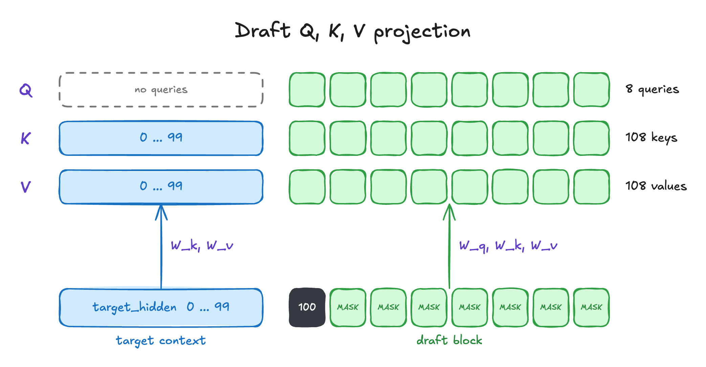
</p>

**Queries** only come from the current draft block, since those are the positions we want to decode (sample) in this step.

On the other hand, **keys and values** come from two sources: the target-derived context features and the current draft-block representations. DFlash projects both into K/V and concatenates them along the sequence dimension.

(this is the reason I mentioned to think the target context as the KV cache and the draft block as the tokens being decoded)

Assuming [Grouped-Query Attention](https://arxiv.org/abs/2305.13245), the tensor shapes become:

```
Q: [B, N_h,    8, d_h]
K: [B, N_kv, 108, d_h]
V: [B, N_kv, 108, d_h]
```

>[!NOTE]
> Here, `N_h` and `N_kv` are the numbers of query and KV heads, while `d_h` is the head dimension. Each KV head matches multiple query heads during the actual attention operation.

This means DFlash computes outputs for just eight positions while letting them read the entire processed context and the current block. Once we understand this, the Q/K/V construction in code is fairly straightforward:

```python
q = self.q_proj(hidden_states)
q = q.view(bsz, q_len, -1, self.head_dim)
q = self.q_norm(q).transpose(1, 2)
k_ctx = self.k_proj(target_hidden)
k_noise = self.k_proj(hidden_states)
v_ctx = self.v_proj(target_hidden)
v_noise = self.v_proj(hidden_states)
k = torch.cat([k_ctx, k_noise], dim=1).view(bsz, ctx_len + q_len, -1, self.head_dim)
v = torch.cat([v_ctx, v_noise], dim=1).view(bsz, ctx_len + q_len, -1, self.head_dim)
k = self.k_norm(k).transpose(1, 2)
v = v.transpose(1, 2)
```
Source: [`Qwen3DFlashAttention.forward`](https://github.com/z-lab/dflash/blob/07ebd93db9f472af339b644bb70221ad8428328a/dflash/model.py#L381-L391).

Note that `ctx_len = 100` here only on the first draft pass. On subsequent iterations, `target_hidden` contains only the newly confirmed tokens (e.g., 3 tokens for positions 100–102), and `past_key_values.update` concatenates those new entries onto the already-cached context K/V.

### Bidirectional Attention Does Not Have Causal Mask

Unlike ordinary causal attention, the standard DFlash block allows its positions to [attend bidirectionally](https://github.com/z-lab/dflash/blob/07ebd93db9f472af339b644bb70221ad8428328a/dflash/model.py#L397-L417).

For our example, the attention pattern looks like this:

<p align="center">
  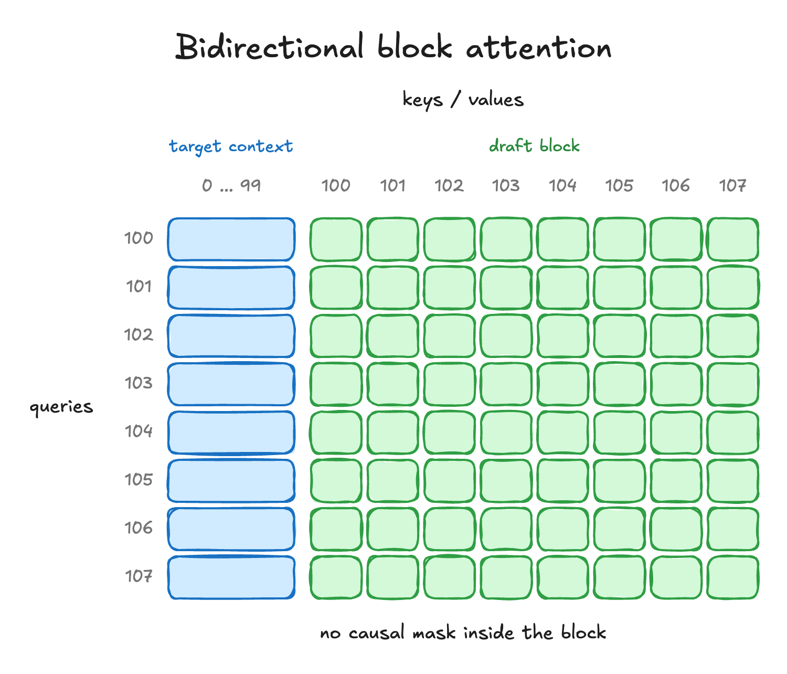
</p>

For instance, the masked position at 103 can attend to the hidden representation at position 104, even though 104 is a **future position**. This is not possible in ordinary autoregressive models since they apply causal masking.

Then how can these masked positions produce different predictions when they initially start with the same mask embedding? DFlash still uses [rotary position embeddings (RoPE)](https://github.com/z-lab/dflash/blob/07ebd93db9f472af339b644bb70221ad8428328a/dflash/model.py#L331-L337) on queries and keys. Although the mask-token embeddings are identical at initialization, their positional encodings differ, giving each slot distinct position information during attention. Therefore, hidden representations evolve differently as they interact with the context and neighboring positions.

After attention, the layer performs the "usual" [residual connections, normalization, and MLP operations](https://github.com/z-lab/dflash/blob/07ebd93db9f472af339b644bb70221ad8428328a/dflash/model.py#L446-L475). These update the block representations while preserving their shape `[B, 8, H]`.

The updated block is passed through the next draft layer, while the same fused target features are independently supplied to that layer through KV injection.

After [all five decoder layers (the default depth in the paper) and the final normalization](https://github.com/z-lab/dflash/blob/07ebd93db9f472af339b644bb70221ad8428328a/dflash/model.py#L586-L597), the output shape remains `[B, 8, H]`.

## Parallel Sampling

Since the anchor is already known, we [discard its output position](https://github.com/z-lab/dflash/blob/07ebd93db9f472af339b644bb70221ad8428328a/dflash/model.py#L243-L249) and keep the remaining seven representations (`[B, 7, H]`). These are passed through the target model's frozen [LM head](https://github.com/z-lab/dflash/blob/07ebd93db9f472af339b644bb70221ad8428328a/dflash/model.py#L599-L605), producing seven vocabulary distributions:

<p align="center">
  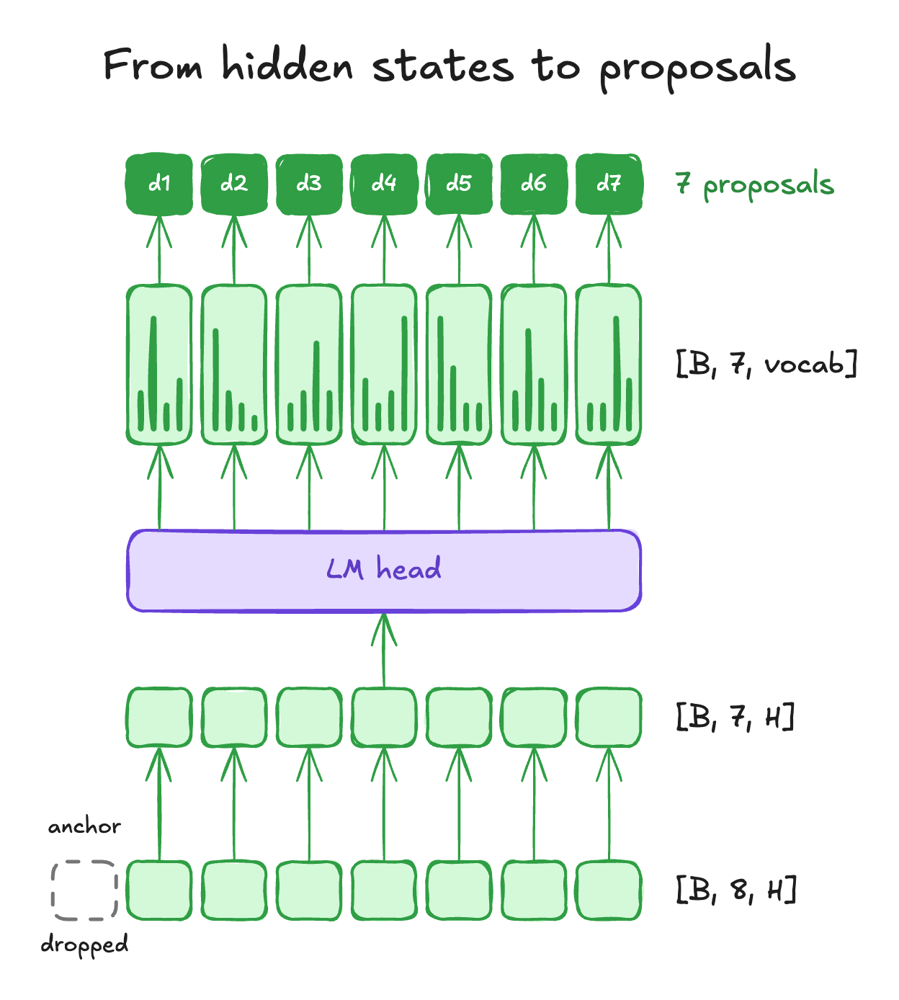
</p>

For greedy decoding, we [select the highest-scoring token](https://github.com/z-lab/dflash/blob/07ebd93db9f472af339b644bb70221ad8428328a/dflash/model.py#L267-L268) at each position. For stochastic sampling, we [sample from the corresponding probability distributions](https://github.com/z-lab/dflash/blob/07ebd93db9f472af339b644bb70221ad8428328a/dflash/model.py#L261-L266) and retain the proposal probabilities for verification.

It is important to note that while past positions can attend to future positions during the forward pass, **they don't know the actual tokens that will eventually be sampled, since sampling also happens in parallel**. In other words, the block can exchange information through hidden representations, but its predictions aren't explicitly conditioned on previously sampled draft token IDs. This later creates a problem known as _suffix decay_, where not knowing what is sampled in previous positions leads to a lower acceptance rate in later positions.

After drafting, DFlash [removes the temporary block K/V entries from the draft cache](https://github.com/z-lab/dflash/blob/07ebd93db9f472af339b644bb70221ad8428328a/dflash/model.py#L250) while retaining the persistent context K/V derived from target hidden states. Those block K/V entries came from speculative, masked representations and are only used during the current draft forward pass; confirmed context is instead added from the target's hidden states after verification.

## Target Verification

After parallel sampling, the target model needs to decide how many prefix tokens can be accepted. It [processes the anchor and all seven proposals together](https://github.com/z-lab/dflash/blob/07ebd93db9f472af339b644bb70221ad8428328a/dflash/model.py#L269-L275), using its existing KV cache for positions 0–99. Since the target model is autoregressive, each output position predicts the _next_ token:

<p align="center">
  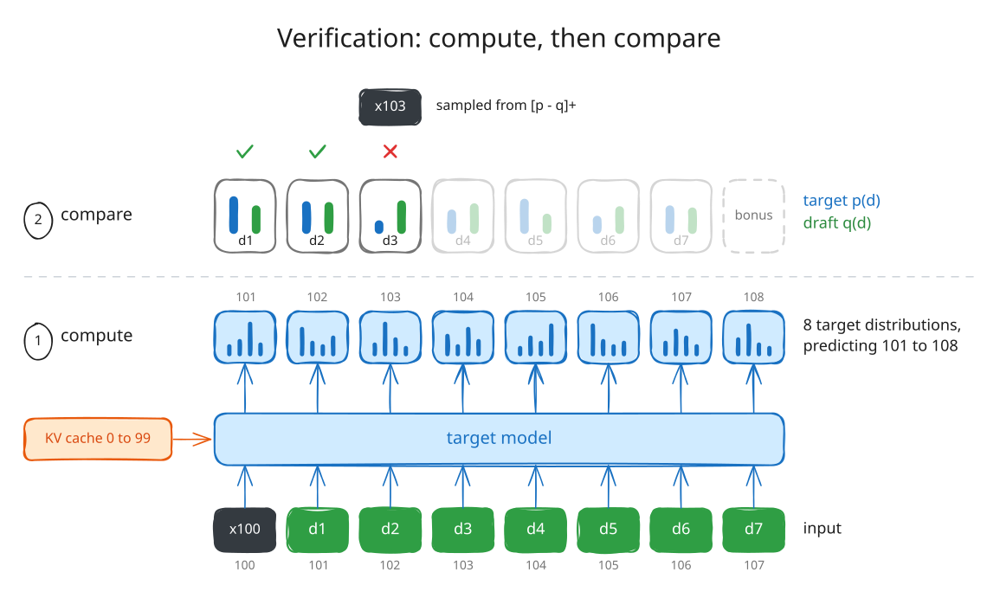
</p>

So a single verification forward pass produces seven distributions for checking our proposals and an additional distribution for the token after the block.

For greedy decoding, verification [compares the proposals against the target's argmax predictions](https://github.com/z-lab/dflash/blob/07ebd93db9f472af339b644bb70221ad8428328a/dflash/model.py#L289-L292) and retains the longest matching prefix.

For stochastic sampling, each proposed token $d_i$ is accepted with probability:

$$
\alpha_i = \min\left(1, \frac{p_i(d_i)}{q_i(d_i)}\right)
$$

where $p_i$ is the target distribution and $q_i$ is the draft distribution; on the first rejection, a replacement token is sampled from the normalized residual $[p_i - q_i]_+$ (or a bonus token from the final target distribution if all proposals pass). Together, this [rejection-sampling method](https://github.com/z-lab/dflash/blob/07ebd93db9f472af339b644bb70221ad8428328a/dflash/model.py#L94-L124) guarantees lossless speculative decoding in stochastic sampling—you can find the detailed explanation and code in [the other post I wrote about rejection sampling](./speculative-decoding-rejection-sampling.md).

## What Happens After Verification?: Update and Repeat!

After verification, we are done with one decode iteration and should prepare the next one. Suppose the target accepts the first two proposals and rejects the third. Our retained sequence becomes:

<p align="center">
  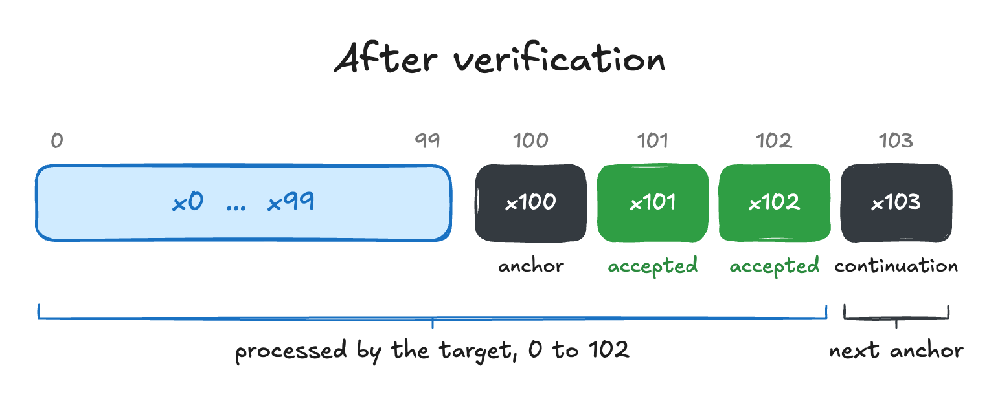
</p>

In this case, token at position 103 has been selected, but **hasn't passed through the target Transformer yet**. This token [becomes the anchor](https://github.com/z-lab/dflash/blob/07ebd93db9f472af339b644bb70221ad8428328a/dflash/model.py#L293-L294) for the next iteration.

There is one more thing we need to consider at this stage, which is how to update the target and draft KV caches. During verification, the target has already computed K/V for all eight positions, including rejected proposals. Therefore, we need to roll back its cache:

<p align="center">
  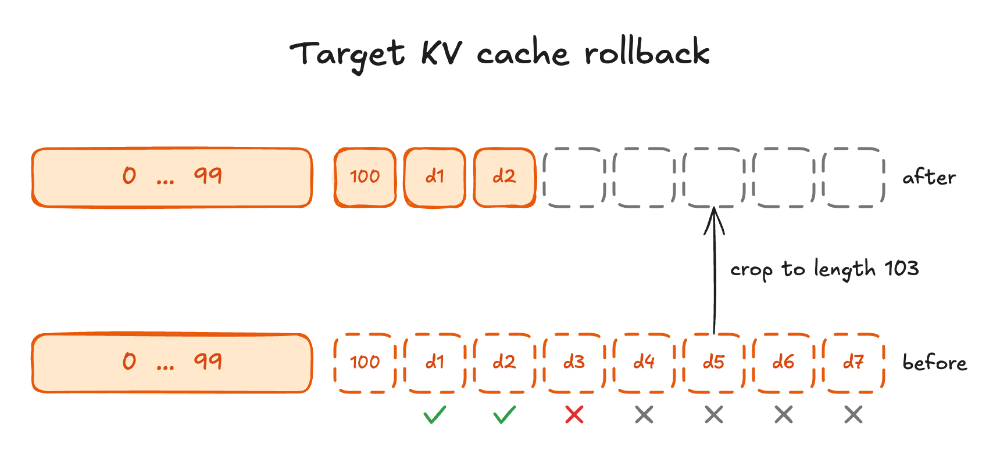
</p>

The target cache is cropped to length 103, retaining positions 0–102.

What about the draft KV cache? Remember that the drafter discards all its temporary block K/V after drafting. Its persistent cache still contains the target-derived context K/V for positions 0–99. To extend it, DFlash uses the hidden states produced by the target during verification. Specifically, it retains the features corresponding to the accepted positions, including the old anchor:

<p align="center">
  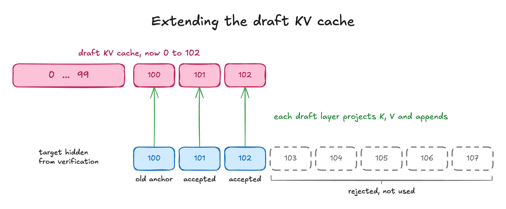
</p>

This includes the previous anchor since we only knew the token embedding of the anchor, not its intermediate hidden states. On the next draft call, these three newly available target feature vectors are fused once through `fc` and `hidden_norm` into `[B, 3, H]`, and each draft layer projects them with its own `k_proj`/`v_proj` into context K/V and [appends them to its existing draft cache](https://github.com/z-lab/dflash/blob/07ebd93db9f472af339b644bb70221ad8428328a/dflash/model.py#L394-L396).

```python
# 1. after draft forward pass: drop temporary block K/V, keep persistent context
_crop_to(past_key_values_draft, start)

# ...

# 2. after verification: roll back rejected target K/V
start += produced
_crop_to(past_key_values_target, start)

# ...

# 3. slice target hidden states (old anchor + accepted tokens)
# to append to draft cache next step
target_hidden = extract_context_feature(output.hidden_states, model.target_layer_ids)[:, :produced, :]
```
Source: [`dflash_generate`](https://github.com/z-lab/dflash/blob/07ebd93db9f472af339b644bb70221ad8428328a/dflash/model.py#L250) (`L250`, [`L303-L308`](https://github.com/z-lab/dflash/blob/07ebd93db9f472af339b644bb70221ad8428328a/dflash/model.py#L303-L308)) and [`_crop_to`](https://github.com/z-lab/dflash/blob/07ebd93db9f472af339b644bb70221ad8428328a/dflash/model.py#L152-L154).

So to summarize the target and draft KV caches at each stage:

|Stage|Target KV cache|Persistent draft KV cache|
|---|---|---|
|After prefill|0–99|Not yet populated|
|After first drafting|0–99|0–99|
|After verification and rollback|0–102|0–99|
|After next drafting|0–102|0–102|

Finally we are ready for the next decode iteration and continue at token position 103 and so on:

<p align="center">
  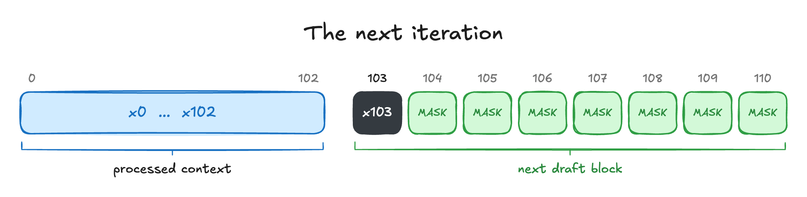
</p>

## Looking Back at Parallel Sampling

Now that we've gone through how the decoder layer works in detail, let's take a step back and understand the insight from DFlash. As the paper mentions, parallel decoding changes an important design tradeoff.

<p align="center">
  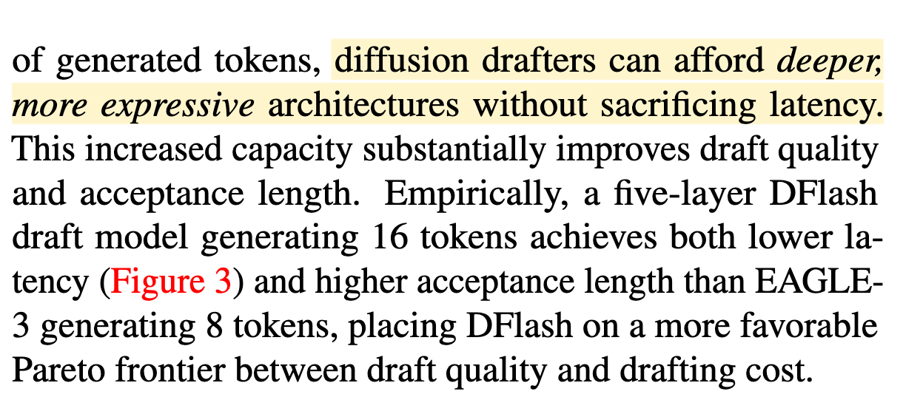
  <br />
  <sub>From the DFlash paper</sub>
</p>

An autoregressive drafter needs to be extremely cheap per step, since its execution cost scales with the number of sequential predictions. So the better quality we want to achieve (e.g., by adding more decoder layers to the draft model) directly **conflicts** with making the draft model cheap. This is why EAGLE-3 uses a shallow, single-decoder layer as its draft model.

However, DFlash can afford higher capacity without paying a full sequential step per token. Since it drafts every position within the block in parallel, the cost of additional layers can be amortized across all the tokens generated. In other words, the cost of going through one forward pass is shared by all the tokens that are drafted together. This makes the latency increase for a more expensive forward pass less significant compared to autoregressive draft models. This is also the reason why we can use five decoder layers instead of one.

<p align="center">
  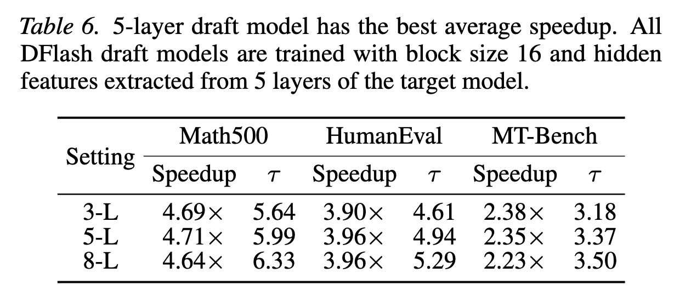
  <br />
  <sub>Table 6 from DFlash paper</sub>
</p>
Looking at the ablation, there seems to be a fundamental tradeoff between layer depth (quality) and speedup. Going deeper usually yields a higher mean acceptance length ($\tau$), but since it passes through additional layers, it can increase end-to-end latency (and reduce overall speedup). This is mentioned again in the DFlash2 article as well!

<p align="center">
  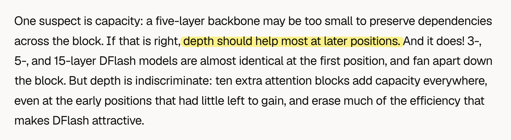
  <br />
  <sub>From DFlash2 article</sub>
</p>


Let's come back to the two questions we asked at the beginning and try to answer them.

> **1. How can DFlash predict the seventh token without knowing what was sampled for the first six?**

Answer to this question is that DFlash allows unknown positions to interact through their representations without requiring them to know one another's sampled token IDs.

> **2. How does a small draft model predict multiple future tokens with enough accuracy?**

Because it conditions on rich hidden representations extracted from the target model at every layer via KV injection, rather than relying entirely on a small standalone language model.

We've now seen the three mechanisms that make DFlash's implementation distinctive: **KV injection for reusing target features, block attention for parallel drafting, and cache management for correctly advancing between speculative rounds**.

Together, these explain how DFlash produces multiple proposals in one backbone pass while preserving the target model's output distribution through verification.

## Limitations of DFlash

Parallelizing block drafting trades away token-by-token conditioning inside the block. Masked positions can exchange hidden representations during the draft pass, but each proposal is still chosen without conditioning on the actual tokens sampled at earlier positions in the same block.

In practice, this shows up in two ways:

1. **Suffix decay:** Even when DFlash proposes 8 to 16 tokens at once, conditional acceptance drops sharply right after the first proposed token (the only position directly conditioned on the known anchor), because subsequent positions have to guess without seeing earlier sampled choices—causing cumulative prefix survival to fall off toward the end of the block.

2. **Wasted verification and batch capacity:** Since verification keeps only a contiguous accepted prefix and stops at the first mismatch, rejected suffix proposals turn into wasted target verification work, leading to inefficient performance.

<p align="center">
  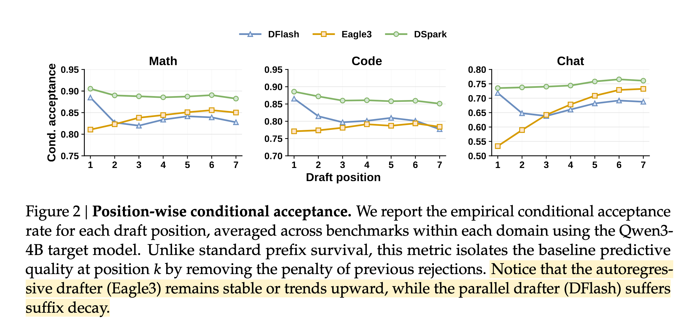
  <br />
  <sub>From the DSpark technical report</sub>
</p>

For example, the [DSpark](https://arxiv.org/abs/2607.05147) technical report illustrates how DFlash's position-wise conditional acceptance drops sharply after the first token, whereas EAGLE-3 stays relatively stable (or even improves in some cases) at later positions.

Follow-up work like DSpark and [DFlash 2](https://inco.ai/blog/dflash2/) directly targets this problem, which I'll cover in a separate article.