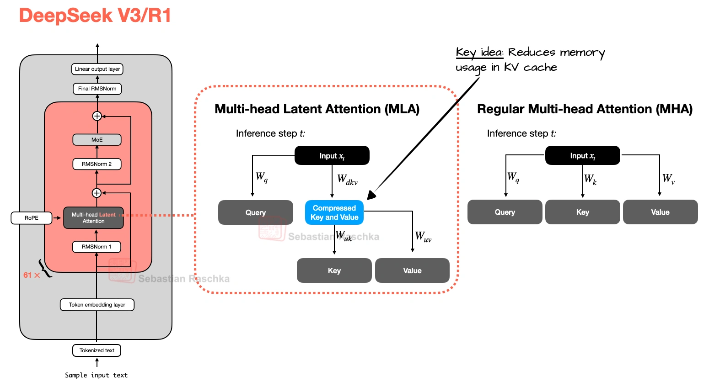
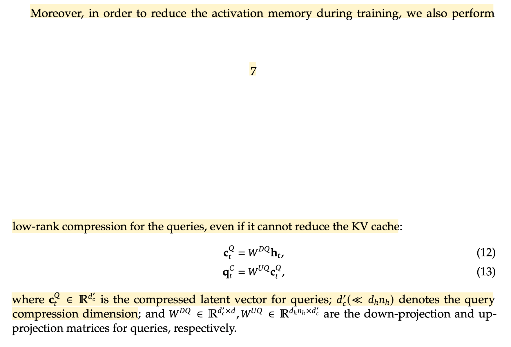
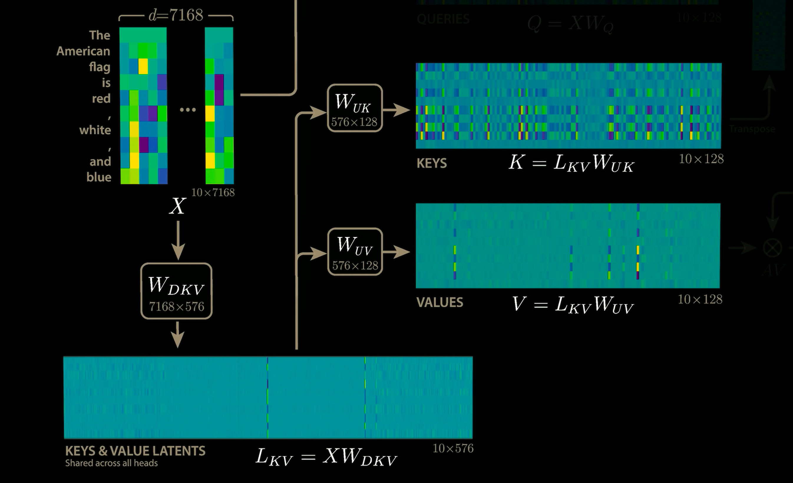
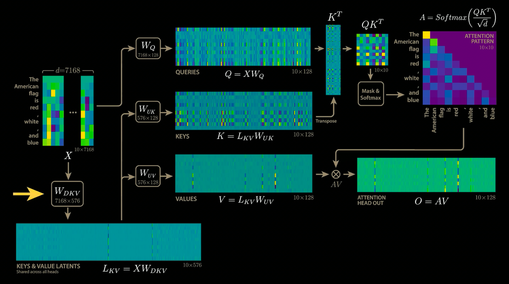
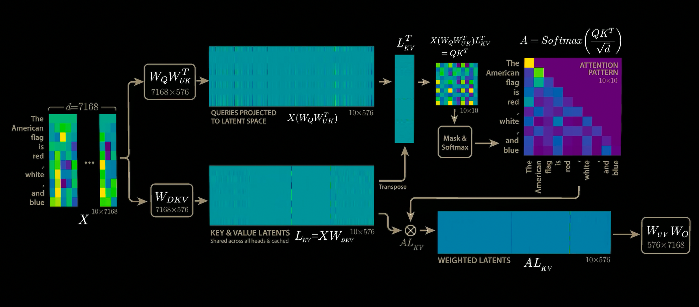
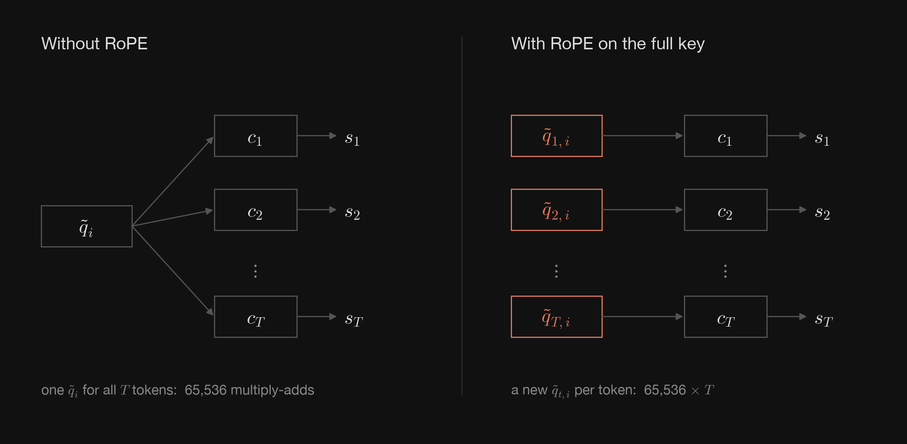
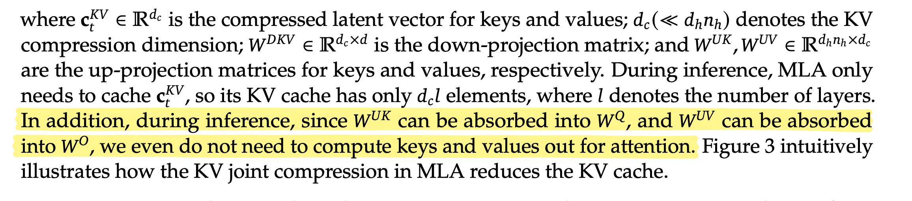
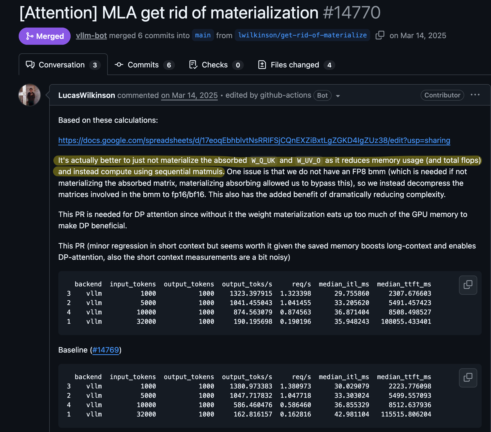
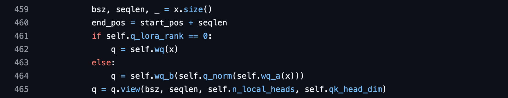

# MLA (Multi-Head Latent Attention) Explained

# Overview

Let's talk about MLA.

We'll first get an overview of MLA and its benefits for long contexts, then work through KV compression, weight absorption, and decoupled RoPE. A reference implementation is available [here](https://github.com/junuxyz/transformer-lab/blob/mla_absorbed/src/components/attention/mla.py).

**MLA** was first introduced in [DeepSeek-V2's technical report](https://arxiv.org/abs/2405.04434). More recent models use MLA or its variants, including [DeepSeek-V3.2](https://huggingface.co/deepseek-ai/DeepSeek-V3.2) with DeepSeek Sparse Attention (DSA), [Kimi K2.7 Code](https://huggingface.co/moonshotai/Kimi-K2.7-Code) with MLA, and [Kimi K3](https://huggingface.co/moonshotai/Kimi-K3) with a hybrid of Kimi Delta Attention (KDA) and Gated MLA.

So what _exactly_ is MLA?

It is a variation of Attention module in Transformer model (originally Multi-Head Attention, introduced in [Attention is All You Need](https://arxiv.org/abs/1706.03762)), where it saves the past KV values (KV Cache) in a low-rank latent space, by using a down projection weight $W^{DKV}$ (which refers to Down projection Weight for KV) and conceptually reconstructs them during inference using up-projection matrices $W^{UK}$ and $W^{UV}$ (which refer to Up projection Weights for K and V).

MLA can require more computation than standard MHA, but reduces the size of the KV cache stored and loaded during decoding. This is because MLA caches one shared KV latent rather than separate keys and values for every head. We will compare this in more detail in the following section. So fundamentally speaking, MLA makes a tradeoff between memory bandwidth (KV Cache size) and compute (FLOPs to calculate), without losing performance.

Since MLA reduces the size of KV Cache per layer per token, we have two advantages where
1. Loading KV Cache from memory is faster
2. We can store more context in the given memory capacity

Now that we've gone through the "interview" answer, let's dive deeper.

# Algorithm

## Notations

### dimensions

| Symbol  | Meaning                                       | Value   |
| ------- | --------------------------------------------- | ------- |
| $d$     | model hidden dimension                        | 5120    |
| $n_h$   | number of attention heads                     | 128     |
| $i$     | head index                                    | 0 … 127 |
| $d_h$   | per-head dimension                            | 128     |
| $d_c$   | KV latent (compression) dimension             | 512     |
| $d'_c$  | query latent dimension                        | 1536    |
| $d_h^R$ | per-head dimension of the decoupled RoPE part | 64      |
| $d_k$   | query/key dimension used for attention-score scaling | $d_h = 128$ without RoPE; $d_h + d_h^R = 192$ with decoupled RoPE |
| $s$     | query token position                          | —       |
| $t$     | key token position                            | —       |
| $T$     | number of cached tokens attended to, including the current token | —       |

### matrices

> [!NOTE]
> - No need to read all of these right now, use these as references when needed!
> - Capital-case for matrix, lower-case for vector

| Symbol               | Shape                  | Meaning                                                                             |
| -------------------- | ---------------------- | ----------------------------------------------------------------------------------- |
| $X$                  | $[1 \times d]$         | input hidden state of one token (during decode)                                     |
| $W^{DQ}$             | $[d \times d'_c]$      | query down-projection                                                               |
| $c^Q$                | $[1 \times d'_c]$      | query latent, $c^Q = XW^{DQ}$                                                        |
| $W_i^{UQ}$           | $[d'_c \times d_h]$    | head $i$'s content-query up-projection                                               |
| $W_i^{QR}$           | $[d'_c \times d_h^R]$  | head $i$'s query projection for the decoupled RoPE part                               |
| $W^{KR}$             | $[d \times d_h^R]$     | head-shared key projection for the decoupled RoPE part                               |
| $W^O$                | $[n_h d_h \times d]$   | output projection of concatenated head outputs                                      |
| $W^{DKV}$            | $[d \times d_c]$       | KV down-projection                                                                  |
| $c$                  | $[1 \times d_c]$       | KV latent of one token, $c = X W^{DKV}$ (the thing we cache; $c^{KV}$ in the paper) |
| $C$                  | $[T \times d_c]$       | all cached latents stacked, one row $c$ per token                                   |
| $W^{UK}, W^{UV}$     | $[d_c \times d_h n_h]$ | key / value up-projections                                                          |
| $W^{UK}_i, W^{UV}_i$ | $[d_c \times d_h]$     | head $i$'s column block of $W^{UK}$ / $W^{UV}$                                      |
| $k^C, v^C$           | $[1 \times d_h n_h]$   | keys / values rebuilt from the latent, $c W^{UK}$ and $c W^{UV}$                    |
| $K_i, V_i$           | $[T \times d_h]$       | head $i$'s keys / values for all cached tokens, $C W^{UK}_i$ and $C W^{UV}_i$       |
| $q_i$                | $[1 \times d_h]$       | head $i$'s query for the current token                                              |
| $\tilde{q}_i$        | $[1 \times d_c]$       | absorbed query, $q_i W^{UK\top}_i$                                                  |
| $a_i$                | $[1 \times T]$         | head $i$'s attention weights, $\text{softmax}(\text{scores}_i)$                     |
| $\tilde{a}_i$        | $[1 \times d_c]$       | attention-weighted latent, $a_i C$                                                  |
| $o_i$                | $[1 \times d_h]$       | head $i$'s attention output                                                         |
| $k^R$                | $[1 \times d_h^R]$     | decoupled RoPE key, shared across heads and also cached                             |
| $R(t)$               | $[d_h \times d_h]$     | RoPE rotation matrix at position $t$, built from frequencies $\theta_j$             |

> [!NOTE]
>
> Throughout the section:
> - We use row vectors (`x @ W`) and DeepSeek-V2’s dimensions.
> - All calculations are **per layer**. DeepSeek-V2 has 60 layers with separate weights and KV caches.
> - We only cover inference, starting with decode path, where one query attends to $T$ cached tokens.

## 1. Low-Rank KV Joint Compression

  
   
  Figure 1. MLA uses a shared KV latent instead of separate per-head keys and values. <a href="#reference-1">[1]</a>

As explained, MLA uses a shared low-rank latent to represent keys and values, with separate up-projections producing each head's keys and values.
### KV Down Projection

During down projection, we project the entire hidden dimension $d$ into latent dimension $d_c$ without separating heads (notice there is no $i$ in the equation below).

The hidden state $X$ of one token is projected by $W^{DKV}$ (we will talk about $W^Q$ later): $$\text{KV Down Projection: } c^{KV} = X W^{DKV} \\ \\ \qquad [1 \times d] \times [d \times d_c] = [1 \times d_c]$$
In DeepSeek-V2, this is $[1 \times 5120] \rightarrow [1 \times 512]$.

From now on we will call $c^{KV}$ as _KV latent_ interchangeably. KV Latent is stored as KV cache for each token, for each layer.

Also keep in mind this is a KV "joint" compression, where we don't save latents for K and V separately but in one KV latent instead.

### KV Up Projection

For attention operation, we need to load the cached latent $C$, which is every past token's $c$ stacked as rows ($[T \times 512]$) and expand each one back into keys and values.

Unlike the down projection, which used a single matrix $W^{DKV}$, the up projection has a separate pair of matrices for each head. Every head uses the same latent $c^{KV}$ but each has its own pair of up-projection matrices, $W^{UK}_i$ and $W^{UV}_i$. You can think of it as each head reading the same compressed vector but in different ways.

$$\text{K Up Projection: } K_{i} = C W^{UK}_i \\ \\ \text{V Up Projection: } V_{i} = C W^{UV}_i \\ \\ [T \times d_c] \times [d_c \times d_h] = [T \times d_h] \text{ for each head}$$

In DeepSeek-V2, each head turns the $[1 \times 512]$ latent into a $[1 \times 128]$ key and a $[1 \times 128]$ value. Across all 128 heads, the up projections produce $16{,}384$ ($128 \times 128$) dimensional keys and $16{,}384$ dimensional values per token, while caching only the shared $512$ dimensional KV latent.

### Q Projection

MLA also compresses the query, projecting the hidden state $X$ into a query latent $c^Q$ before up-projecting it into each head's query. These projections run during both training and inference. While query compression does not reduce the KV cache, it is used to reduce activation memory during training.

  
   
  Figure 2. The DeepSeek-V2 report introduces query compression to reduce training activation memory. <a href="#reference-2">[2]</a>

As described in Section 2.1.2 of the paper,<a href="#reference-2">[2]</a> query compression reduces activation memory during training and uses a separate compression dimension $d'_c$, independent of $d_c$. DeepSeek-V2 uses $d_c = 512$ and $d'_c = 1{,}536$.

### Comparing Projection Shapes in MHA vs MLA

Now that we've gone through how MLA compresses and projects its Q, K, and V, let's compare the Q, K, V projections in MHA and MLA.

In MHA, each head projects directly from the hidden states. In MLA, all heads share a query down-projection and a joint KV down-projection, then use their own up-projection matrices.

| Projection | MHA            | MLA                        |
| ---------- | -------------- | -------------------------- |
| Query      | $q_i = XW_i^Q$ | $q_i = (XW^{DQ})W_i^{UQ}$  |
| Key        | $K_i = XW_i^K$ | $K_i = (XW^{DKV})W_i^{UK}$ |
| Value      | $V_i = XW_i^V$ | $V_i = (XW^{DKV})W_i^{UV}$ |

The weight shapes are:

| Weight | MHA                     | MLA                                                              |
| ------ | ----------------------- | ---------------------------------------------------------------- |
| Query  | $W_i^Q: [d \times d_h]$ | $W^{DQ}: [d \times d'_c]$, $W_i^{UQ}: [d'_c \times d_h]$         |
| Key    | $W_i^K: [d \times d_h]$ | $W^{DKV}: [d \times d_c]$, $W_i^{UK}: [d_c \times d_h]$          |
| Value  | $W_i^V: [d \times d_h]$ | The same $W^{DKV}$ as the key, then $W_i^{UV}: [d_c \times d_h]$ |

This gives the following shape changes for each head:

| Projection | MHA                                       | MLA                                                                   |
| ---------- | ----------------------------------------- | --------------------------------------------------------------------- |
| Query      | $[1 \times d] \rightarrow [1 \times d_h]$ | $[1 \times d] \rightarrow [1 \times d'_c] \rightarrow [1 \times d_h]$ |
| Key        | $[T \times d] \rightarrow [T \times d_h]$ | $[T \times d] \rightarrow [T \times d_c] \rightarrow [T \times d_h]$  |
| Value      | $[T \times d] \rightarrow [T \times d_h]$ | $[T \times d] \rightarrow [T \times d_c] \rightarrow [T \times d_h]$  |
As seen here, the final shapes are the same for both cases: $[1 \times d_h]$ for the query and $[T \times d_h]$ for the cached keys and values.

Here is a visual explanation on Q compression / projection and KV compression / projection from a YouTube video I watched which I found helpful:

  
   
  Figure 3. A shared KV latent is up-projected into keys and values. <a href="#reference-5">[5]</a>

  
   
  Figure 4. Naive MLA reconstructs keys and values before computing attention. <a href="#reference-5">[5]</a>

## 2. Weight Absorption, or Attention Without K/V Reconstruction

> [!NOTE]
> All costs below are **per head**.

### Naive decoding

As mentioned above, cache $C$ refers to every past token's KV Latent $c$ stacked as rows ($[T \times 512]$). When a new token comes in, its query is split into 128 heads where head $i$'s query $q_i$ is $[1 \times 128]$.

So how do we compute attention score?

The most intuitive way is to rebuild the keys from the cache, then calculate the attention score $S_i$ against them:

$$S_i = \frac{q_i K_i^\top}{\sqrt{d_k}} = \frac{q_i \left(C W^{UK}_i\right)^\top}{\sqrt{d_k}}$$

We can break this down into two steps:

1. Projected $K_i$: $K_i = C\, W^{UK}_i$: $[T \times 512]\,[512 \times 128] = [T \times 128]$, costing $131{,}072\,T$
2. Attention score: $S_i = q_i\, K_i^\top$: $[1 \times 128]\,[128 \times T] = [1 \times T]$, costing $256\,T$

We can see where the cost comes from. Attention score computation is relatively cheap, but to get there we push **every row of the cache** through $W^{UK}_i$, and we do this again for every decoding step. The longer the context ($T$) gets, the worse it becomes.

It turns out there is a much cheaper way to get the exact same result.

> [!NOTE]
> If you're familiar with RoPE (Rotary Positional Embedding), you might wonder why we haven't applied it to Q and K. We're intentionally omitting RoPE for now to focus on the core idea of **weight absorption**. We'll revisit it in Section 3, where we'll see why RoPE complicates weight absorption and how MLA addresses this.

### Weight Absorption

What if we _don't_ up-project K right away?

Let's come back to the attention score equation.

$$S_i = \frac{q_i K_i^\top}{\sqrt{d_k}} = \frac{q_i \left(C W^{UK}_i\right)^\top}{\sqrt{d_k}}$$

What we did above was to do $K_i = C\, W^{UK}_i$ first (in the parentheses) and then do matrix multiplication with $q_i$. However, since matrix multiplication is **[associative](https://en.wikipedia.org/wiki/Matrix_multiplication)**, we are free to choose which product to compute first.

Using the transpose rule $(AB)^T = B^TA^T$, we can reverse the order of the matrices inside the transpose as:

$$S_i = \frac{q_i K_i^\top}{\sqrt{d_k}} = \frac{q_i \left(C W^{UK}_i\right)^\top}{\sqrt{d_k}} = \frac{q_i W^{UK\top}_iC^\top}{\sqrt{d_k}}$$

Then, by the associative property of matrix multiplication, we can compute ($q_i W_i^{UK\top}$) first and multiply the result by ($C^T$). Intuitively, you can think of $\tilde{q}_i$ as each query head projected into the latent space.

So instead of applying $W^{UK}_i$ to all $T$ rows of the cache $C$, we can apply it **once to the query**:

1. Absorbed query $\tilde{q}_i = q_i\, W^{UK\top}_i$: $[1 \times 128]\,[128 \times 512] = [1 \times 512]$. This costs $131{,}072$, **independent of $T$.**
2. Attention score $\text{scores}_i = \tilde{q}_i\, C^\top$: $[1 \times 512]\,[512 \times T] = [1 \times T]$. This costs $1{,}024\,T$.

Interestingly, while the result is mathematically identical, the cost of compute is very different:

|                      | FLOPs                    |
| -------------------- | ------------------------ |
| Naive (Non-absorbed) | $131{,}328\,T$           |
| Absorbed             | $131{,}072 + 1{,}024\,T$ |

Absorption reduces the $T$-dependent cost from $131{,}328\,T$ to $1{,}024\,T$, while adding $131{,}072$ FLOPs to transform the query. For integer $T \ge 2$, this uses fewer FLOPs than naive reconstruction and avoids materializing $K_i$ during decode.

  
   
  Figure 5. Weight absorption computes attention from the cached latent without reconstructing full keys and values. <a href="#reference-5">[5]</a>

The same kind of optimization can be applied during value aggregation, where we compute the weighted sum of the values with attention weights.

Each head's output before the final projection $W^O$ can be expressed as:

$$o_i = a_i V_i = a_i(C W_i^{UV}) = (a_i C)W_i^{UV} \\ \\ \text{where } a_i = \mathrm{softmax}(S_i).$$

Again, by associativity, there are two ways to get the same output.

**Naive (Non-absorbed):** Up project the cached latents first, then compute their weighted sum.

1. **Value Projection:** $V_i = C W_i^{UV}$: $[T \times 512][512 \times 128] = [T \times 128]$, costing $131{,}072T$ FLOPs.
2. **Weighted Value Aggregation:** $o_i = a_i V_i$: $[1 \times T][T \times 128] = [1 \times 128]$, costing $256T$ FLOPs.

**Absorbed:** Compute the weighted sum of the cached latents first, then up-project the result.

1. **Weighted Latent Aggregation:** $\tilde{a}_i = a_i C$: $[1 \times T][T \times 512] = [1 \times 512]$, costing $1{,}024T$ FLOPs.
2. **Value Projection:** $o_i = \tilde{a}_i W_i^{UV}$: $[1 \times 512][512 \times 128] = [1 \times 128]$, costing $131{,}072$ FLOPs.

The value projection now operates on one aggregated latent instead of all $T$ cached latents. We never materialize the full $[T \times 128]$ value matrix $V_i$.

The cost per head, excluding the common final output projection, is:

| | FLOPs |
| --- | --- |
| Naive (Non-absorbed) | $131{,}328\,T$ |
| Absorbed | $1{,}024\,T + 131{,}072$ |

In both paths, we concatenate the $[1 \times 128]$ head outputs and apply the same output projection:

$$O = \mathrm{Concat}(o_0,\ldots,o_{n_h-1})W^O$$

## 3. Decoupled RoPE (Rotary Positional Embedding)

Decoupled RoPE is the final part to understand to draw the full picture of MLA.

It turns out [RoPE](https://arxiv.org/abs/2104.09864) is **incompatible** with weight absorption, which we've just been talking about! Or to be more precise, we can use weight absorption but that won't lead to the optimization we've seen when RoPE is applied.

Why is so? Let's first recall how RoPE is calculated. RoPE rotates Q and K matrices after their projection. This can be expressed as a $[2 \times 2]$ rotation matrix, where for every pair of dimensions at token position $t$:

$$\begin{bmatrix} x'_{2j} & x'_{2j+1} \end{bmatrix} = \begin{bmatrix} x_{2j} & x_{2j+1} \end{bmatrix} \begin{bmatrix} \cos t\theta_j & \sin t\theta_j \\ -\sin t\theta_j & \cos t\theta_j \end{bmatrix}$$
where
- $x'$ denotes the rotated vector
- $j \in \{0, \dots, d_h/2 - 1\}$ indexes the dimension pair
- $\theta_j = 10000^{-2j/d_h}$ is the rotation frequency for that pair

Let $s$ be the query position and $t$ the key position. The score becomes:

$$(q R(s))(k R(t))^{\top} = q\, R(s-t)\, k^{\top}$$

Now let's put this into MLA. Without RoPE, the score against token $t$ is what we saw in weight absorption:

$$\text{score}_i(s,t) \text{ (without RoPE)} = \big(q_i(s)\, W^{UK\top}_i\big)\, c_t^{\top}$$

Applying RoPE, the rotated key of token $t$ is $k_i(t) = c_t W^{UK}_i R(t)$, so $R(s-t)$ lands right in the middle:

$$\text{score}_i(s,t) \text{ (with RoPE)} = \big(q_i(s)\, R(s-t)\, W^{UK\top}_i\big)\, c_t^{\top}$$

As seen in the equation, if we apply RoPE, the absorbed query $\tilde{q}_i(s,t) = q_i(s)\, R(s-t)\, W^{UK\top}_i$ contains $R(s-t)$ in the middle which **differs** for each past token. So, while keeping only the latent cache, we need a **separate $\tilde{q}_i(s,t)$ per token**: the same $[1 \times 128] \times [128 \times 512]$ product **$T$ times**.

  
   
  Figure 6. Applying RoPE to the full key makes the absorbed query depend on each key position.

### RoPE Projection

In order to avoid this scenario and use weight absorption, MLA **decouples** RoPE from the KV latent. Intuitively, you can think of this as splitting up content information and position information explicitly.

Each query and key is split into:

1. a content part that is never rotated (what we've seen in Sections 1–2)
2. a small RoPE part ($d_h^R = 64$) in charge of position information

Looking at just the RoPE part: the query side projects the compressed query $c^Q$ $[1 \times 1536]$ with $W^{QR}_i$ $[1536 \times 64]$, one per head, so $128 \times [1536 \times 64]$ in total. The key side projects the raw hidden state $X$ $[1 \times 5120]$ with $W^{KR}$ $[5120 \times 64]$. Unlike $W^{QR}$, $W^{KR}$ is **shared across all heads**, so we only cache one 64-dim RoPE key per token.

$$q^R_i = \text{RoPE}\big(c^Q\, W^{QR}_i\big), \qquad k^R = \text{RoPE}\big(X\, W^{KR}\big)$$

The score is now the sum of the two parts:

$$\text{score}_i(s,t) = \big(q_i(s)\, W^{UK\top}_i\big)\, c_t^\top + q^R_i(s)\, (k_t^R)^\top$$

Since the first term involves no rotation, weight absorption works exactly as before. In code, the content components of the query and key are often labeled `nope`, short for “no positional embedding,” because RoPE is not applied to them.

The second term has the rotation, but $k^R$ never goes through $c$ or $W^{UK}$, so we can cache it already rotated and use it directly. In total, the cache holds $512 + 64 = 576$ elements per token.

> [!NOTE]
> Value-side absorption $(a_i C)\, W^{UV}_i$ is unaffected since RoPE only applies to Q and K. So QK reads all 576 elements per token, while AV only needs the 512 of $c$.

For the same query-head count, per-head dimension, and cache dtype, the KV cache sizes per token per layer are:

| Method | Cache elements per token per layer |
| --- | --- |
| MHA | $2n_h d_h$ |
| GQA | $2n_{kv}d_h$ |
| MQA | $2d_h$ |
| MLA | $d_c + d_h^R = 576$ |

Here, $n_{kv}$ is the number of KV heads in GQA.

With BF16, MLA stores $576 \times 2 = 1{,}152$ bytes per token per layer. For 60 layers, batch size 1, and $T = 32{,}768$, the total KV cache payload is $1{,}152 \times 60 \times 32{,}768 = 2{,}264{,}924{,}160$ bytes, or about **2.11 GiB**.

### Putting the FLOPs together

We can now put the pieces together. For one decode token, both paths create the query, cache the new token's KV latent and RoPE key, and apply the final output projection. Absorption only changes the computation between these projections.

We count an $[m \times k]$ by $[k \times n]$ matrix multiplication as $2mnk$ FLOPs, with one fused multiply-add (FMA) counting as 2 FLOPs. All counts below are for batch size 1, one decode token, and one layer, across all 128 heads.

Using the dimensions above, the matrix-multiplication costs are:

| Stage                                                    |             Naive |                      Absorbed |
| -------------------------------------------------------- | ----------------: | ----------------------------: |
| Query down- and up-projections, including the RoPE query |            91.23M |                        91.23M |
| New token's KV latent and RoPE key projections           |             5.90M |                         5.90M |
| Content attention, as derived in Section 2               | $33{,}619{,}968T$ | $33{,}554{,}432 + 262{,}144T$ |
| RoPE attention scores                                    |       $16{,}384T$ |                   $16{,}384T$ |
| Final output projection                                  |           167.77M |                       167.77M |

The shared projections cost about **264.90M FLOPs per decode step**, independent of context length. Adding attention gives:

$$\begin{aligned} F_{\text{naive}}(T) &= 264{,}896{,}512 + 33{,}636{,}352T,\\ F_{\text{absorbed}}(T) &= 298{,}450{,}944 + 278{,}528T. \end{aligned}$$

| Context length $T$ |   Naive | Absorbed |
| ------------------ | ------: | -------: |
| 1                  | 298.53M |  298.73M |
| 1,024              |  34.71G |  583.66M |
| 32,768             |   1.10T |    9.43G |

We can see a clear win as context length $T$ grows, since absorption removes the need to reconstruct every cached key and value during decode step.

> [!NOTE]
> These counts exclude normalization, RoPE rotations, score scaling, and softmax.

## Is Weight Absorption Always the Best Choice?

### On precomputing merged query weights

DeepSeek describes both under weight absorption. Here, we use "merged weights" specifically for weight products that are precomputed and stored.

I didn't mention this when explaining weight absorption but we can also consider precomputing $W_i^{QK} = W_i^{UQ} W_i^{UK\top}$, combining the query up projection with the key up projection. In this case, instead of computing $q_i$ and transforming it into the latent space, we project $c^Q$ directly using the merged weights.

  
   
  Figure 7. The DeepSeek-V2 report describes absorbing key and value up-projections into query and output projections. <a href="#reference-2">[2]</a>

Since the merged weights can be reused while the model parameters remain fixed, we need only one matrix multiplication $c^Q W_i^{QK}$ instead of two separate projections.

However, after doing some research myself, I found that most inference implementations do not precompute merged weights, contrary to the description of the paper. For example, [vLLM removed the materialized query/key and value/output weight products in favor of sequential matrix multiplications, citing lower memory usage and FLOPs](https://github.com/vllm-project/vllm/pull/14770).

  
   
  Figure 8. vLLM replaces materialized weight products with sequential matrix multiplications. <a href="#reference-3">[3]</a>

[DeepSeek-V3's public inference implementation](https://github.com/deepseek-ai/DeepSeek-V3/blob/main/inference/model.py) also evaluates the absorbed computation through sequential operations. It directly projects `wq_b` (query up projection weight) right after `wq_a` (query down projection weight) and normalization, instead of merged weights.

  
   
  Figure 9. DeepSeek-V3 applies query down-projection, normalization, and up-projection sequentially. <a href="#reference-4">[4]</a>

The relevant codes can be found in https://github.com/junuxyz/transformer-lab/blob/mla_absorbed/src/components/attention/mla.py.

> [!NOTE]
> I may add some more advanced section as I learn more details on fast and efficient MLA approaches such as [FlashMLA](https://github.com/deepseek-ai/FlashMLA) or in [Flash Infer](https://github.com/flashinfer-ai/flashinfer) and how MLA is used in recent frontier models.

Thanks for reading and feel free to reach out if there's anything misleading or unclear.

# References

1. Sebastian Raschka. [Multi-Head Latent Attention (MLA)](https://sebastianraschka.com/llm-architecture-gallery/mla/).
2. DeepSeek-AI. [DeepSeek-V2 technical report, Section 2.1.2](https://arxiv.org/abs/2405.04434).
3. vLLM. [MLA get rid of materialization, PR #14770](https://github.com/vllm-project/vllm/pull/14770).
4. DeepSeek-AI. [DeepSeek-V3 inference implementation](https://github.com/deepseek-ai/DeepSeek-V3/blob/main/inference/model.py).
5. Welch Labs. [How DeepSeek Rewrote the Transformer [MLA]](https://www.youtube.com/watch?v=0VLAoVGf_74).
